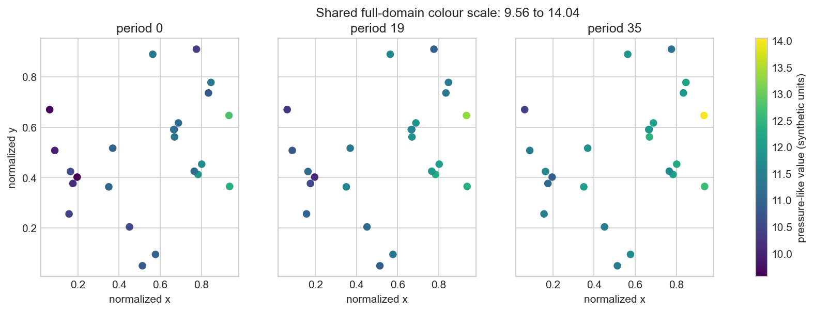
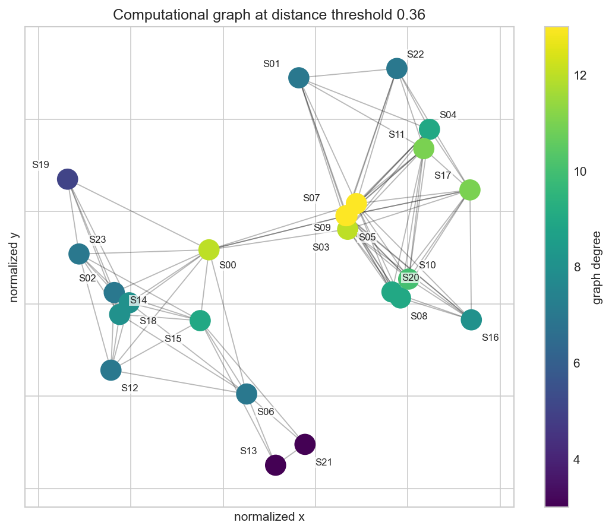

# FPWM Lab

> Fake field, real experiments.

FPWM Lab is a notebook-first look at spatial and time-series baselines on a
fictional pressure-like field. Everything here is synthetic: 24 invented sites, 36
synthetic periods, normalized coordinates, and values expressed only in
synthetic units.

That gives the notebooks room to show their work. You can inspect the
generator, change one assumption, check the graph, and follow the residuals
without mistaking the result for a claim about a real field or a finished
model.

## Start here

The notebooks form one continuous investigation. Read them in order.

| Notebook | Question | Main output |
| --- | --- | --- |
| [01 — Synthetic field investigation](notebooks/01_synthetic_field_investigation.ipynb) | Can we build a useful synthetic field without hiding its assumptions? | Auditable observations, missingness diagnostics, and controlled noise sensitivity |
| [02 — Spatial and temporal analysis](notebooks/02_spatial_temporal_analysis.ipynb) | How do graph and holdout choices change the experiment? | Distance diagnostics, graph sensitivity, and leakage-safe partitions |
| [03 — Evaluation and diagnostics](notebooks/03_evaluation_and_diagnostics.ipynb) | What do simple baselines reveal before model development? | Predictions, residuals, sensitivity checks, and protocol-specific scorecards |

Each notebook follows the same rhythm: inspect the data, make one change,
check the result, visualize it, and explain what the evidence supports.

## Questions worth poking at

1. Can a transparent synthetic generator produce spatial and temporal structure
   worth investigating?
2. How should chronological prediction and spatial interpolation be separated
   so their information boundaries remain honest?
3. What can simple baselines reveal about residual structure, leakage, and
   sensitivity before a more complex model is justified?

The working assumptions are deliberately modest. Distance defines a
computational neighbourhood, not physical communication. Periods 0–27 are used
for chronological training and periods 28–35 for later-period testing. A
separate five-site boundary holdout studies same-period spatial interpolation.

Simple baselines make leakage risks, holdout sensitivity, and residual
structure easier to inspect. Chronological prediction and same-period
interpolation use different information, so their scores answer different
questions rather than forming one leaderboard.

## Results at a glance

The two evaluation protocols answer different questions. They are shown
separately on purpose.

### Later-period prediction

All three baselines train on periods 0–27 and predict observed rows from periods
28–35.

| Baseline | n | MAE | RMSE | Bias |
| --- | ---: | ---: | ---: | ---: |
| Per-site linear trend | 178 | 0.225458 | 0.269812 | -0.065418 |
| Per-site persistence | 178 | 0.320228 | 0.395955 | -0.261640 |
| Global mean | 178 | 0.602560 | 0.802759 | 0.402273 |

The per-site trend is the strongest chronological reference in this synthetic
experiment. Its residuals are still structured, so the result is a useful
baseline—not a solved forecasting problem.

### Same-period spatial interpolation

The spatial experiment withholds five eastern-boundary sites and predicts them
from other sites observed during the same period.

| Baseline | n | MAE | RMSE | Bias |
| --- | ---: | ---: | ---: | ---: |
| Distance-weighted KNN, k=5 | 157 | 0.649611 | 0.876292 | 0.586843 |

This is interpolation evidence, not a forecast. Results for alternative
neighbour counts and the controlled noise experiment are collected in
[RESULTS.md](RESULTS.md).

## A visual tour

### The synthetic field



The snapshots share the full synthetic response range; no observations are
clipped. They show how the constructed spatial surface changes after temporal,
seasonal, site-level, and localized perturbation components are added.

### The computational graph



Node colour represents graph degree. The graph is built from normalized
distance and is useful for computational experiments only. It is not evidence
of subsurface connectivity.

## Reproduce the study

Python 3.10–3.13 is exercised on Windows and Ubuntu in CI.

### Windows PowerShell

```powershell
py -3.12 -m venv .venv
.\.venv\Scripts\python.exe -m pip install --upgrade pip
.\.venv\Scripts\python.exe -m pip install -r requirements.txt -r requirements-dev.txt
.\.venv\Scripts\python.exe -m jupyter lab
```

### macOS or Linux

```bash
python3 -m venv .venv
.venv/bin/python -m pip install --upgrade pip
.venv/bin/python -m pip install -r requirements.txt -r requirements-dev.txt
.venv/bin/python -m jupyter lab
```

Open `notebooks/` and run the three notebooks in numeric order. To execute them
headlessly without changing the committed copies:

```bash
python tools/run_notebooks.py --output-dir build/executed
```

On Windows, replace `python` with `.\.venv\Scripts\python.exe`.

Then run the research checks:

```bash
python -m pytest -q
python -m ruff check .
```

The notebooks regenerate every CSV in `data/generated/` from the recorded seed.
Their deterministic identities are checked by the test suite.

## Repository guide

```text
notebooks/        the three executed research notebooks
data/generated/   synthetic observations, partitions, graph edges, and scores
docs/images/      figures used in this README
tests/            scientific invariants and publication-boundary checks
tools/            deterministic notebook execution helper
DATA_CARD.md      provenance, schema, intended use, and limitations
RESULTS.md        compact score and sensitivity tables
LICENSE           MIT terms for the independently authored repository content
```

## What this establishes (and what it doesn't)

The synthetic generator is reproducible, the information boundaries are
explicit, and the baseline errors can be inspected spatially and temporally.

The experiments do **not** establish geological realism, reservoir
communication, causal behaviour, calibrated uncertainty, operational
forecasting performance, or the quality of any private model.

Read [DATA_CARD.md](DATA_CARD.md) before reusing the generated artifacts.

## References

The presentation and research flow were informed by the
[Liquid AI cookbook](https://github.com/Liquid4All/cookbook) and the
[Data Engineering Handbook](https://github.com/DataExpert-io/data-engineer-handbook).
The scientific stack is built with
[NumPy](https://numpy.org/), [pandas](https://pandas.pydata.org/),
[SciPy](https://scipy.org/), [NetworkX](https://networkx.org/),
[Matplotlib](https://matplotlib.org/), and
[scikit-learn](https://scikit-learn.org/).

## License

The independently authored content in this repository is available under the
[MIT License](LICENSE).

`SPDX-License-Identifier: MIT`

The license does not extend to external projects cited as research references.
